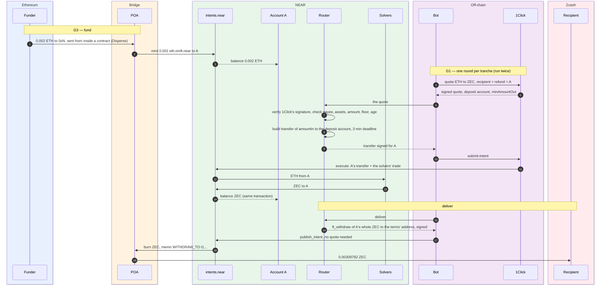

# PoC — Intents v2 on mainnet, 2026-10-21

One full v2 round run by hand on mainnet: ETH forwarded from a contract into a NEAR Intents account,
swapped to ZEC under the router's rules, delivered to a Zcash address. It answers the three gates
that blocked the router ([verification.md](verification.md)) and changes one part of the design: the
counterparty is a **1Click quote**, not an unquoted limit order.

Total cost: 0.002 ETH in, 0.00309782 ZEC out, plus Ethereum gas.

## The test account

A throwaway Ed25519 key, generated for the run, standing in for the MPC-derived `A`. To
`intents.near` both are an implicit account signing with its own key; MPC signing itself is proven
by `utxo-withdraw` in production.

|                                   |                                                                                                                   |
| --------------------------------- | ----------------------------------------------------------------------------------------------------------------- |
| Account `A`                       | `f1c78fbe493b9817dd9ce77a0d3959390742effc017af4be39e5563228e64ec5`                                                |
| Key                               | `ed25519:HGokQV5V7oAgdhYBzkj8Ej4HNFThU1TogFYRNrw64wyv`                                                            |
| POA deposit address `0xN` (eth:1) | `0x04624e5890ed9c703D94652E19E4e327E2F4002a`                                                                      |
| Verifier                          | `intents.near` v0.4.5, [`16d04f6`](https://github.com/near/intents/tree/16d04f6ec4401263f8914638710260da50bb46b0) |

## The round

```
ETHEREUM   0.002 ETH → Disperse → 0xN          internal transfer, as IntentReceiver makes
POA        credits A with 0.002 eth.omft.near   1 min 16 s after the Ethereum block
NEAR       round 1: 0.001 ETH → 0.00191014 ZEC  1Click quote, verified, router-built transfer
           round 2: 0.001 ETH → 0.00190768 ZEC  the catch-up, same way
           ft_withdraw 0.00381782 ZEC → POA     router-shaped delivery intent, no quote
ZCASH      0.00309782 ZEC to t1...   POA fee 0.00047 + 0.00025 on chain, ~3 min after NEAR
```

### Who does what

| Party | Where | Role in the round | In v2 |
| --- | --- | --- | --- |
| **Funder** | Ethereum | sends ETH through Disperse | `IntentReceiver`, forwarding each order's ETH |
| **POA** (`bridge-mng.near`) | Ethereum ↔ NEAR | owns `0xN`; credits `A` with `eth.omft.near`; pays out withdrawals on their chain | same |
| **`A`** | NEAR, in `intents.near` | holds ETH, then ZEC; moves only by a signature for its key | the MPC-derived account of one action |
| **Router** | NEAR | verifies the quote, checks it, builds and signs every intent for `A` — here the test key | `IntentRouter`, signing through `v1.signer` |
| **Bot** | off-chain | asks 1Click for a quote, carries signed intents to 1Click and the relay; decides nothing — here the PoC scripts | the relayer's intents app, NEAR gas key only |
| **1Click** | off-chain + its deposit account | signs the quote; receives the transfer; has the solvers trade; returns the ZEC to `A` | same |
| **Solvers** | NEAR | the counterparty: take the ETH, give the ZEC (round 1 through two of them) | same |
| **`intents.near`** | NEAR | verifies every signature and nonce; settles each round atomically | same |
| **Recipient** | Zcash | `t1KPVSRgnFHPBWMJLC7taJioN6m5Q6jVBma`, fixed by the terms | the user's address |



Every movement out of `A` — the transfer at step 11, the withdrawal at step 18 — needs a router
signature (steps 7–9 and 16); the bot only carries what the router signed.

## Transactions

| Step        | Chain    | Transaction                                                                                                                        | What happened                                                                                                                                         |
| ----------- | -------- | ---------------------------------------------------------------------------------------------------------------------------------- | ----------------------------------------------------------------------------------------------------------------------------------------------------- |
| Fund (G3)   | Ethereum | [`0xe9b127ec…991a57`](https://etherscan.io/tx/0xe9b127ec18bf893e2e83c208b04aa56ccaf4921dd697fd4eb6956cf628991a57)                  | Disperse forwards 0.002 ETH to `0xN`, block 26240618, 11:16:59 UTC                                                                                    |
| Credit (G3) | NEAR     | [`EjYCSNTh…CCnz`](https://nearblocks.io/txns/EjYCSNThjaCjsp3CLXYsnjj35Ttc4VPPzAnBBeQcCnz)                                          | `bridge-mng.near` mints 0.002 `eth.omft.near` to `A`, 11:18:03                                                                                        |
| Swap 1 (G1) | NEAR     | [`5QXkF5wi…pPJQ`](https://nearblocks.io/txns/5QXkF5wiDejCosH3oAg48q8RcQiyBhuVCPvfwHk5pPJQ)                                         | `A`'s transfer to 1Click deposit account `2e2df800…bdae` (intent `6F1cNJSu…ZzVJ`); solvers route ETH → wNEAR → ZEC; 191014 ZEC units to `A`, 12:18:06 |
| Swap 2 (G1) | NEAR     | [`EkNbiWTq…ozHY`](https://nearblocks.io/txns/EkNbiWTqKhWPZvWfENEaiicJQPafEQFp1Zwsnf44ozHY)                                         | the catch-up: transfer to `85d6616e…fdb76` (intent `HUVbTR8B…dxMq`); 190768 ZEC units to `A`, 12:21:15                                                |
| Deliver     | NEAR     | [`3dREza2s…ZzgL`](https://nearblocks.io/txns/3dREza2sySTPs5CcaSVCCgPXJspSPiua3jzJcYvLZzgL)                                         | `ft_withdraw` of 381782 ZEC units, memo `WITHDRAW_TO:t1KPV…`, burned for POA (intent `B5YFa7Uk…KGN3`), 12:25:09                                       |
| Payout      | Zcash    | [`3bef2003…cd2d`](https://blockchair.com/zcash/transaction/3bef2003d0ca5f85228fe20cfe15397b89c87a547e99da7df011dada16d8cd2d) | POA pays 309782 zats to `t1KPVSRgnFHPBWMJLC7taJioN6m5Q6jVBma`, 12:28 (block 3525524)                                                                                  |

Each swap is **one atomic NEAR transaction**: `A`'s transfer into the deposit account, the solvers'
trade and the ZEC back to `A` all land together. 1Click's custody never outlives the transaction.
How a 0.001 ETH round splits (both rounds identical):

| To              | ETH            |                                               |
| --------------- | -------------- | --------------------------------------------- |
| the solver      | 0.000997999002 | the trade                                     |
| `5880ad2b…47dd` | 0.000002       | 20 bps `appFees` configured on our 1Click key |
| `7066024d…7f05` | 0.000000000998 | 1Click's own fee                              |

## G2 — the bytes `intents.near` verifies

Through the free `simulate_intents` view, against the deployed verifier. 12/12:

| Case                                                        | Verdict                                                                |
| ----------------------------------------------------------- | ---------------------------------------------------------------------- |
| Empty intents — signature, nonce, deadline only             | accepted                                                               |
| Swap, swap + withdraw                                       | past authentication, stopped on balance only                           |
| Deadline 30 s ahead, nonce expiry equal (v2's order expiry) | accepted                                                               |
| Deadline after the nonce expiry                             | `deadline is greater than nonce` — **deadline must be ≤ nonce expiry** |
| Corrupted signature, double hash, a key that did not sign   | `invalid signature`                                                    |
| Deadline in the past                                        | `deadline has expired`                                                 |
| Wrong salt                                                  | `invalid salt`                                                         |
| Plain random nonce                                          | accepted (legacy nonces still work)                                    |
| `signer_id` another account                                 | `public key … doesn't exist for account`                               |

- **Digest:** `sha256(LE_u32(2³¹ + 413) ‖ borsh({message, nonce, recipient, callback_url: None}))`,
  signed once — not hashed again.
- **Versioned nonce:** `5628f6c6 ‖ 0x00 ‖ salt (4, current_salt) ‖ expiry i64 ns LE ‖ entropy (15)`.
- **Implicit account:** its own key is valid on `intents.near` with no registration
  (`has_public_key` true).

## G3 — POA credits ETH forwarded by a contract

Disperse sends ETH from inside a contract call, the internal transfer `IntentReceiver` makes.
POA listed the deposit 27 s after the Ethereum block and credited the full 0.002 ETH
at 1 min 16 s. `0xN` is stable across requests. POA's ETH minimum is 1e11 wei; its ETH withdrawal
fee is 0.000035 ETH.

## G1 — a counterparty

**An unquoted limit order is refused.** `publish_intent` with `quote_hashes: []` accepts only a
bundle that balances on its own (withdrawals, transfers); a lone `token_diff` is
`token deltas have positive balance` at publish time, before any solver sees it. On
NEAR Intents the counterparty exists only through a quote.

**The relay's own quotes need a relay partner key.** Without one, `quote` answers for a few pairs
(USDC → USDT on NEAR) and returns `null` for everything from ETH; a 1Click key does not open it.
`publish_intent` itself needs no key.

**1Click works** with our partner key:

1. **Quote**, non-dry, `depositType`, `recipientType` and `refundType` all `INTENTS`, recipient and
   refund both `A`.
2. **Verify 1Click's signature.** Ed25519 under the manager key
   `ed25519:reYaWhvwu8Jzo3WUM3zhn6VrhuMEF4eADL17qtRVifc`, over the UTF-8 of
   `base58(sha256(stableJson(fields)))` — a fixed whitelist of the request (assets, amount,
   `recipient`, `refundTo`, their types, deadline, …), the quote's amounts and, non-dry,
   `depositAddress`, deadline and fees, plus `timestamp`. Reproduced independently
   (the router's `quote.rs`, on both rounds' quotes); swapping recipient, refund, deposit account, an amount or the
   timestamp breaks it. `appFees`, `partnerId`, `correlationId` are not signed.
3. **The router's checks** on the verified quote: pays and refunds `A` only, ETH → the terms'
   asset, amount ≤ `A`'s balance, `minAmountOut` ≥ the floor, quote younger than the price
   validity.
4. **The router builds the transfer itself** — exactly `amountIn` of ETH to `depositAddress`, a
   3-minute deadline, its own nonce — rather than signing 1Click's generated intent, which was the
   same transfer with a **3-day** deadline. 1Click's `submit-intent` accepted it.
5. Filled in 7 s, round 1 at 191014 against a quote of 191044, `minAmountOut` 189133 and our floor
   180000 (1.8 ZEC/ETH).

**1Click's generated intent is a transfer, not a `token_diff`.** For a public swap the funds go to
the quote's deposit account and 1Click pays the recipient; the docs' `token_diff` example does not
apply. That is why the router has to verify the quote's signature: it is the only thing binding the
deposit account to recipient `A`.

## Delivery

`ft_withdraw` of the whole ZEC balance to the terms' address, published with no quote.
POA lists `min_withdrawal_amount` 0.01 ZEC for `zec:mainnet:native`; it paid out **0.0038 ZEC
anyway**. What a delivery costs is 0.00072 ZEC: POA's listed 0.00047 fee, and 25,000 zats more taken on chain (likely the miner fee) — POA's status reported `withdraw_amount` 334782, the transaction paid 309782. Small DCA tranches should batch deliveries
in `A` (above a threshold, or every N tranches) — a route-registry setting.

## v1, v2 as specified, v2 as proven

v2 as specified ([spec.md](spec.md)) dropped 1Click and posted an unquoted limit order; G1 showed
the relay refuses that. The PoC brings 1Click back for one thing only — the counterparty — while
everything the spec moved into `A` stays there.

| Step | v1 (live, [../intents/spec.md](../intents/spec.md)) | v2 as specified — 1Click dropped | v2 as proven — 1Click quote + router |
| --- | --- | --- | --- |
| Who starts | the user calls `placeOrder` with a 1Click quote | ICE forward → dispatcher | ICE forward → dispatcher |
| Price on Hydration | none — 1Click quoted | oracle floor in the order VAA | oracle floor in the order VAA |
| ETH lands in | 1Click's deposit address, random per quote | `A`, through POA `0xN` | `A`, through POA `0xN` |
| Who holds the funds while waiting | 1Click | `A`, under the router | `A`, under the router |
| Counterparty | 1Click's solvers, picked by 1Click | an unquoted limit order on the relay | a 1Click quote, requested by the bot per tranche |
| What the router signs | — no router | a `token_diff` at the floor | a transfer of `amountIn` to the quote's deposit account, once 1Click's signature verifies and the quote pays and refunds `A`, at or above the floor, fresh |
| Held by 1Click | from deposit until delivery | never | within the one swap transaction; the output lands back in `A` |
| Delivery | 1Click withdraws to the user | router signs a withdrawal from `A` | router signs a withdrawal from `A` |
| Refund | 1Click, to `refundTo` | router, after the deadline | router, after the deadline; a failed swap is refunded by 1Click to `A` |
| `finalize` | — | `(terms, orderVaa)` | `(terms, orderVaa, quote)` |
| Works | yes | no — refused at publish (G1) | yes — two rounds on mainnet |

Against the spec, one step changes: where the counterparty comes from. Against v1, 1Click goes
from custodian of the whole flow to price and solver access for a single swap — it never chooses
where the money goes, and never holds it beyond that transaction.

## Threats — the bot supplies the quote

The bot asks 1Click for every tranche's quote, and `finalize` is permissionless, so anyone can play
the bot. The router trusts nothing in the quote except what 1Click's key signed — and the signed
set includes `recipient`, `recipientType`, `refundTo`, `refundType`, `depositAddress`, the assets,
the amounts and the timestamp. Sending funds anywhere but `A` takes a quote 1Click signed saying so.

| Attack | What stops it | Left over |
| --- | --- | --- |
| A quote paying the attacker | `recipient` and `refundTo` signed; the router requires both = `A`, types `INTENTS` | — |
| A real quote with `recipient` edited | the signature breaks (`quote.rs` tests) | — |
| A real quote, the transfer aimed elsewhere | the router builds the transfer itself, to the signed `depositAddress` | — |
| One quote finalized twice — two transfers | **to add:** nonce entropy from `depositAddress`, so a re-sign repeats the nonce and cannot execute | today a second deposit is refunded to `A` |
| A stale quote at an old price | the timestamp is signed; the router requires it fresher than the price validity | — |
| A huge `slippageTolerance` | `minAmountOut` is signed; the router requires it ≥ the oracle floor | — |
| `appFees` to the attacker — **not in the signed set** | they lower the signed `amountOut` / `minAmountOut`, which must stay ≥ the floor | skim up to market − floor per round |
| A worse-priced quote on purpose | the same floor check | skim up to market − floor per round |
| Other delivery modes — `virtualChainRecipient`, `customRecipientMsg`, `EXACT_OUTPUT` | **to add:** require them empty, `swapType` `EXACT_INPUT`, `dry` false, `depositType` `INTENTS` | — |
| Withholding, or a flood of quotes | funds wait in `A`; a second whole-balance transfer fails on balance when it executes | delay only |
| 1Click's manager key leaks | nothing on our side: a forged quote can name any deposit account | up to what one round transfers |
| 1Click takes a deposit and neither swaps nor refunds | nothing on our side | one swap's amount |

**What is left.** Value extraction down to the floor — bounded by `maxSlippageBps`, the residual the
spec already accepts for its own orders, now sharper: keep the floor tight, DCA slippage small. And
1Click itself — its signing key, and its conduct within one swap — in place of v1's custody of the
whole flow.

**For the router:**

- swap nonce entropy derived from `depositAddress` — one execution per quote;
- strict quote fields: `dry` false, `swapType` `EXACT_INPUT`, `depositType` `INTENTS`, no
  `virtualChainRecipient` / `virtualChainRefundRecipient` / `customRecipientMsg`;
- a per-round cap on `amountIn`, so a leaked key or a misbehaving 1Click costs one tranche, not a
  whole DCA balance;
- a set of 1Click keys, changed only by the DAO, so a rotation announced in advance has no gap; the
  bot checks each quote against it and alerts on a mismatch.

## What it changes in the design

- **The counterparty is 1Click.** `finalize(terms, orderVaa, quote)` — decided 2026-10-21. The
  quote is 1Click's response, checked against 1Click's signing key held in the router's config
  (changed by the DAO); the floor stays the oracle price the order VAA carries.
- **No number from the bot is trusted.** It supplies the quote; the router accepts it only under
  1Click's signature, paying and refunding `A`, at or above the floor.
- **The router builds every intent itself**, with deadlines it chooses — never a payload generated
  elsewhere.
- **Trust added:** 1Click's manager key signs honestly, and 1Click completes a swap it was paid
  for. Its custody is bounded by one atomic transaction in both rounds observed.
- **Fees seen:** the `appFees` set on the partner key (20 bps here) and ~0.0001% to 1Click, both
  deducted from the input; 0.00072 ZEC per POA delivery (0.00047 listed + 0.00025 on chain).

## Not covered

- MPC signing of these exact payloads (the router does not exist yet). The signing primitive is
  the one `utxo-withdraw` uses.
- A refund path (1Click refunding `A`, or the router refunding after the deadline).
- Quote unavailability over a long DCA — the catch-up rule covers it by design, untested.
- Any destination but ZEC, any origin but ETH.
